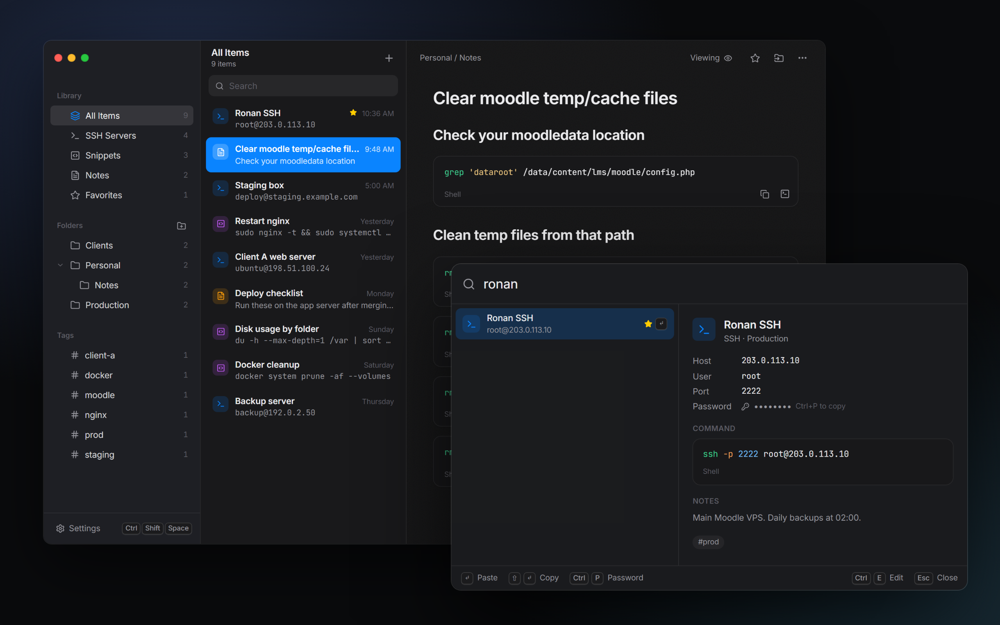
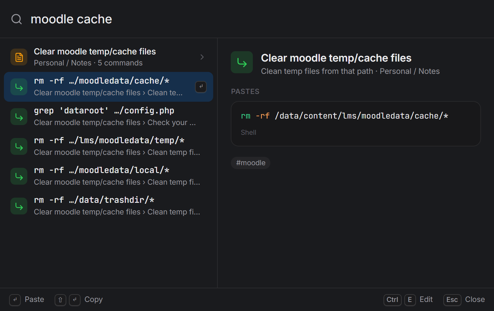
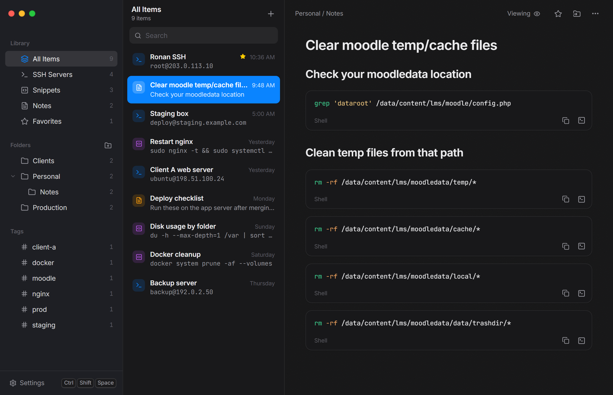
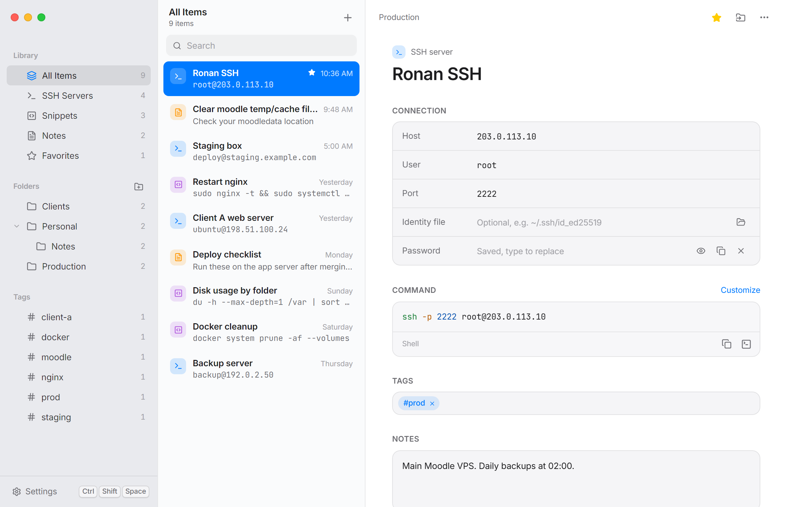

<p align="center">
  
</p>

<h1 align="center">Ronan Launcher</h1>

<p align="center">
  Your SSH servers, shell snippets and runbook notes, one shortcut away.<br>
  <a href="https://github.com/0phl/ronan-launcher/releases/latest"><b>Download for Windows</b></a>
</p>

<p align="center">
  
</p>

A Windows tray app that keeps your SSH connections, snippets and runbook notes one shortcut away.
Press **Ctrl+Shift+Space** anywhere, type a few letters (`ronan`), press **Enter**, and the command
is pasted into the window you were just in: Windows Terminal, PuTTY, Notepad, anything.

## Install

1. Download `RonanLauncher-<version>-x64-setup.exe` from the [latest release](https://github.com/0phl/ronan-launcher/releases/latest).
2. Run it. It installs just for your user, so there's no admin prompt.
3. Windows SmartScreen may say it "protected your PC", because the installer isn't code-signed yet. Click **More info → Run anyway**.
4. Press **Ctrl+Shift+Space** to open the launcher. The library window opens from the tray icon.

Requires 64-bit Windows 10 or 11. WebView2 is already part of Windows 11; on Windows 10 the installer downloads it if needed.

## Features

- **SSH servers**: host, user, port, identity file and an optional password. The `ssh …` command is generated for you, or you can write your own.
- **Snippets**: single commands or multi-line Linux scripts, with syntax highlighting and notes.
- **Runbook notes**: headings and text, plus command blocks with **Copy** and **>_ Paste** buttons. In the launcher, press → or Tab on a note to pick one of its commands.
- **Folders, tags and favorites**: frequently and recently used items rank higher in search.
- **Never presses Enter**: pasted commands always wait for you to review them.
- **Local only**: data lives in `%APPDATA%\com.ronan.launcher\data.db`. Passwords are encrypted with your Windows account (DPAPI).
- **Export / Import**: a password-protected `.ronan` file (Argon2id + AES-256-GCM) moves your library to another PC. Import can merge (newer edits win) or replace (a backup is made first).
- Light and dark themes, Mica/Acrylic translucency, a customizable shortcut, and start with Windows.

## Launcher keys

| Key | Action |
| --- | --- |
| `Enter` | Paste into the previous window |
| `Shift+Enter` | Copy only |
| `→` / `Tab` | Open a note's commands (`←` to go back) |
| `Ctrl+P` | Copy the server's password (cleared from the clipboard after 30 s) |
| `Ctrl+E` | Edit in the library |
| `Ctrl+N` | New item |
| `Esc` | Close |

## Screenshots

**Find one command inside a runbook.** Search matches the commands inside your notes, and Enter pastes the selected one.



**Runbook notes.** Headings, text and command blocks, each with Copy and Paste-to-terminal buttons.



**Light mode.** Follows Windows, or pick Light or Dark in Settings.



## Development

Requirements: Node 20+, Rust (stable, MSVC), Visual Studio Build Tools with the C++ workload, WebView2.

```sh
npm install
npm run tauri dev      # run the app with hot reload
npm test               # frontend unit tests (vitest)
cd src-tauri && cargo test   # backend tests: storage, merge, DPAPI, export crypto
npm run tauri build    # installer in src-tauri/target/release/bundle/nsis/
```

Layout: `src/popup` (launcher), `src/manager` (library window), `src/lib` (search, markdown, API),
`src-tauri/src` (`db.rs` storage, `export.rs` encryption, `focus.rs` + `paste.rs` auto-paste,
`hotkey.rs`, `windows.rs`, `commands.rs`).

## License

[MIT](LICENSE) © 2026 Ronan
